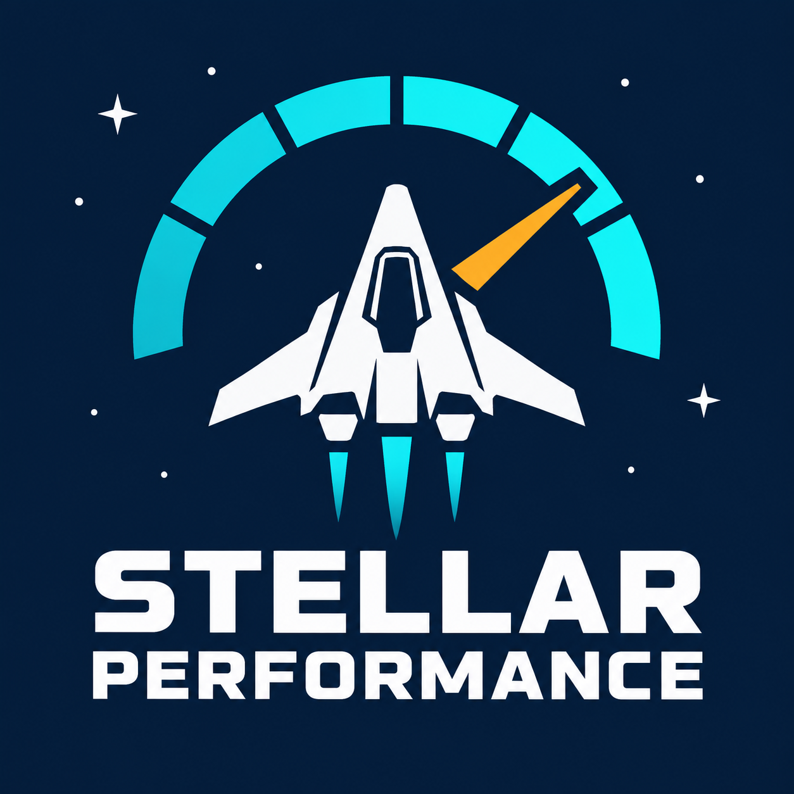

# Stellar Performance

Performance improvements for StellarDrive Demo, reduced to a five-feature core for the
1.0.0. Simulation, physics, network, picking, UI and visual refresh rates stay
native. Room gas rounding can differ slightly.

## What it does

- Caches ship grid bounds and invalidates them on native grid mutations.
- Caches fluid cable visual topology, recomputing live flows and native visuals every frame.
- Rebuilds edited room regions locally, retaining native wall/gas handling.
- Uses authoritative room queries for single-player hosts, restoring the local mirror for peers and debug views.
- Batches inspected fixed opaque part meshes, with compatibility guards and native-renderer restoration for interactions.

The earlier factory cadence, stable-signal skipping, picking throttle, visual caps,
UI throttling and other secondary caches have been removed. Old saved keys cannot
reactivate them. Five feature switches and one batching compatibility option remain.

Six paired runs in the recorded 20-ship world measured **47.98% lower mean frame time**,
with median per-run FPS rising from **36.78 to 70.56** on the tested PC and mod stack.
Scope, raw-evidence provenance and limits are in the [1.0.0 benchmark report](docs/BENCHMARKS.md).
The [0.9.0 feature audit](docs/FEATURE_AUDIT.md) explains why the other features were removed;
its old timings are historical and are not measurements of this candidate.

## Install

**Windows | StellarDrive Demo 0.8.2 | MelonLoader 0.7.3**

Download [StellarPerformance.zip](https://github.com/SilentHacks/StellarPerformance/releases/download/v1.0.0/StellarPerformance.zip), close the game, and extract it into the game directory.
The DLL should be at `Mods/StellarPerformance.dll`. SDModKit is optional.
To uninstall, close the game and remove the DLL.

See the [development guide](docs/DEVELOPMENT.md) to build from source and
[release notes](docs/RELEASE_NOTES.md) for upgrade details.

## Settings and help

Settings are under `[StellarPerformance]` in `UserData/MelonPreferences.cfg`.
Changes require a restart.

- [Settings and compatibility](docs/CONFIGURATION.md)
- [Validation and known limits](docs/VALIDATION.md)
- [Current benchmark evidence](docs/BENCHMARKS.md)
- [Historical pre-1.0.0 claims audit](docs/CLAIMS_AUDIT.md)
- [Changelog](CHANGELOG.md)

Licensed under [MIT](LICENSE). See [credits](CREDITS.md).
